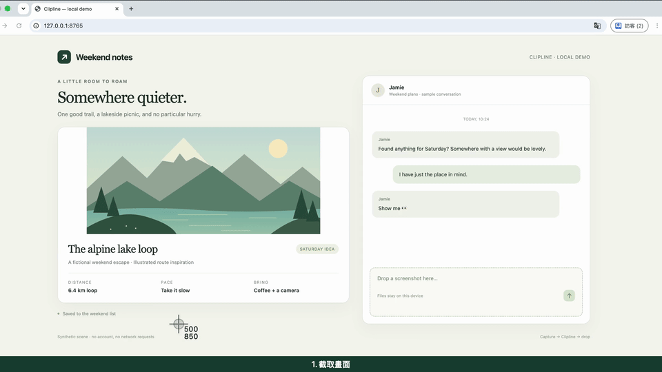

# Clipline


A customized macOS screenshot and clipboard shelf, based on [Alejandro Buján's Tendedero](https://github.com/alejandrobujan/tendedero) 1.0.0. Clipline is an independent modified build with its own name and icon.

**[Download the installer](https://github.com/a2289866844/clipline/releases/latest)** · macOS 14 or later · Universal app for Apple Silicon and Intel

## Install and use

1. Download `Clipline-1.1.4-universal.dmg` from Releases.
2. Open the disk image, drag `Clipline.app` to `Applications`, and launch it.
3. If macOS blocks the app, open **System Settings → Privacy & Security**, find the Clipline notice, and choose **Open Anyway**. This shared build uses an ad-hoc signature and is not notarized by Apple. See [Apple's opening instructions](https://support.apple.com/guide/mac-help/mh40616/mac).
4. Allow access to your screenshot folder when macOS asks; an update may prompt again. The paperclip in the menu bar is Clipline.

Since 1.1.2, if screenshots are saved directly to Desktop during initial setup, Clipline creates a **Desktop/Screenshots** folder and directs new screenshots there. On Chinese-language systems, the folder is named **截圖**. This setting remains after quitting the app. Existing custom locations are preserved, and later manual changes are respected. Old screenshots are not moved; removing a card for this folder from the shelf does not delete its original file.

Press **Control + Option + T** to show or hide the shelf. **Click a card to open its contents**; to copy it, right-click and choose **Copy**. Drag cards into other apps to share them: images and files are delivered as files, text as its full contents, and links as URLs. Text cards show a summary, but copying and dragging preserve the full text. When dragging an image or file into a folder, the destination can choose to move it; a completed move removes its card from the shelf.

**Hang copied items**, introduced in 1.1.0, is enabled by default. It adds newly copied images, text, HTTP(S) links, and files to the shelf. Turn it off in the menu bar to pause collection. Clipline skips content carrying protected clipboard markers, but cannot identify every password or confidential item; pause collection before copying sensitive content. Shelf contents are saved locally and restored after restarting. Clipboard-generated images, text, and links are stored in `~/Library/Application Support/Clipline/Clipboard`; external file cards retain references to their original files.

The shelf has a limited capacity of **3–12 slots**, depending on screen width. When full, the oldest card drops off; this is a temporary shelf with limited capacity. Cards have a consistent height, and images fit fully inside them with their aspect ratio preserved and no cropping.

On first launch, Clipline asks whether to manage your screenshot location. You can choose **Not now**.

Enabling **Handle screenshots** saves new screenshots to `~/Library/Application Support/Clipline/Screenshots` and disables macOS floating thumbnails. Turning this option off or quitting normally restores your previous settings. In this mode, clicking the cross on an image sends its file to Trash. Avoid enabling this feature alongside another tool that also manages screenshot settings.

If macOS **Show Floating Thumbnail** is enabled, a screenshot may appear in Clipline only after the bottom-right thumbnail disappears and the file is saved. To keep your existing save location while showing screenshots promptly, press **Command + Shift + 5 → Options** and disable **Show Floating Thumbnail**. Clipline's own new-item preview still lasts 3 seconds.

## Shelf behavior

- Hover over the MacBook's notch to reveal the shelf. Moving across the rest of the menu bar does not open it. Displays without a notch use a centered **180-point** region at the top.
- Staying in the reveal region for about **0.08 seconds** opens the shelf.
- After a hover reveal, the shelf stays open throughout the display's **upper third** and closes when the pointer leaves that area.
- **New screenshots or clipboard items preview for 3 seconds** when idle. Each new item restarts the timer. Holding a card, dragging, or using its context menu postpones dismissal until the interaction ends. If the pointer remains in the reveal region when the shelf closes, move it away before revealing again.
- A shelf opened with the shortcut or menu stays open until the pointer enters and then leaves it; it closes **5 seconds** after that departure.
- Switching apps or desktops does not reset the dismissal timer. Full-screen Spaces are supported.
- Image cards are enlarged, and repeated opening and closing at the top edge has been fixed. Press and hold an image to open Markup; other card types have no long-press action.
- Fixes cover new screenshots failing to reveal a full shelf, truncated lists after restarting, and images being permanently missed before they finish writing.
- Since 1.1.1, Desktop screenshots are recognized using either macOS extended attributes or screenshot markers inside the image. Ordinary Desktop images are not automatically added.
- Since 1.1.4, screenshot monitoring recovers automatically when folder access becomes available after an initial failure. It also reconnects if the watched folder is replaced. Captures made while startup waits for permission remain eligible for collection.

## Build from source

Requires the macOS Swift toolchain, provided by Xcode or Command Line Tools.

```sh
git clone --branch personal https://github.com/a2289866844/clipline.git
cd clipline
swift test
scripts/build-app.sh
open build/Clipline.app
```

`scripts/make-dmg.sh` builds the app and produces a DMG, ZIP, and SHA-256 checksum file. `personal` is the shared-build branch; `main` retains the upstream baseline, and separate `fix/*` branches are used for upstream pull requests.

## Verification

Regression tests cover display-region boundaries, preview timing, capacity and restoration, clipboard contents and storage, and click and drag data formats. Release verification also requires checking the universal arm64/x86_64 app, signature, and installer. Automated tests do not establish manual verification across every display, full-screen app, or drag-and-drop destination.

## Demo and bug reports

**13-second native demo: take a screenshot → Clipline shelf → drag into a chat composer.** Click the preview to watch the MP4.

[](https://github.com/a2289866844/clipline/releases/download/clipline-v1.1.3/Clipline-1.1.3-demo.mp4)

The demo uses synthetic travel content and a local chat composer that receives the actual image file through native drag and drop. Nothing is uploaded or sent over the network. The recording uses a verification build compiled from the same app sources with separate storage folders. See [the demo notes](docs/demo.md).

Report problems through [GitHub Issues](https://github.com/a2289866844/clipline/issues), including your macOS and Clipline versions, steps to reproduce, expected behavior, and actual behavior. Remove private content before sharing screenshots or recordings.

## Attribution and license

The upstream MIT source-code license and author attribution are preserved in [LICENSE](LICENSE). The original name and icon are not included in that license; this build's icon is drawn by its own script. The Swift target and source directory retain the name `Tendedero` to help track upstream changes. The released app name, bundle ID, preferences, and screenshot storage folders use Clipline.
