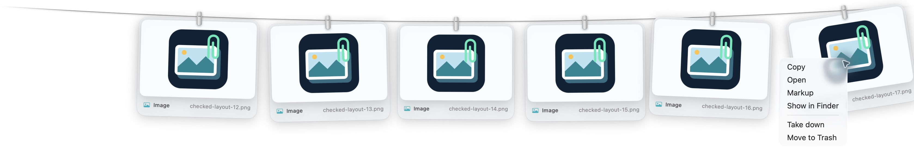

# Clipline 1.1.4 程式碼審查與修正

審查日期：2026-10-11（America/Vancouver）。基準為 [Clipline 1.1.4](https://github.com/a2289866844/clipline/releases/tag/clipline-v1.1.4)，提交 `5877cbb890a1d80a26ee96277c2dbb876f1fe830`。已核對本機 HEAD、遠端 release tag 與 `personal` 分支一致，開始時工作目錄乾淨。修正位於 `codex/clipline-1.1.4-review`。

## 結果

已修正截圖監控、剪貼簿隱私、檔案所有權與生命週期、設定還原、Markup 回寫及原生互動的問題。原版 65 個測試通過仍不足以涵蓋這些邊界；新增重現測試並保留原有測試。以下按相關失敗情境分組，並非每一列都代表單一獨立 bug。

| 優先級 | 原有失敗情境與影響 | 修正與驗證 |
|---|---|---|
| P1 | 剪貼簿延遲提供來源或 PNG 時換成受保護內容，後續讀取可能請求新剪貼簿的秘密資料，雖然最終拒絕交付 | `ClipboardWatcher` 在讀取前及各格式之間核對 `changeCount`；兩種競態測試確認私密 provider 被讀取零次 |
| P1 | 同一張截圖後來經 Finder 複製，既有卡片未升級為原檔引用；位於 Inbox/Clipboard 的檔案可能被當作可丟棄副本 | `Line` 保存原檔引用，連結目標亦受保護；跨移除、重啟與舊孤立檔清理的測試通過 |
| P1 | 已複製的自產圖片掉出架子後，檔案在 0.6 秒後刪除，剪貼簿留下失效的檔案 URL | 保存一個目前複製圖片的引用，直到剪貼簿版本改變；重啟仍能保留有效引用。每兩秒只讀取計數器，釋放後保留 0.6 秒清理間隔 |
| P1 | 編輯 A 後再啟動 B，單一 `editing` 路徑可能讓 A 的回呼覆寫 B；編輯中的自產檔也可能先被容量清理 | Markup 限制一個活動編輯，核對 service 與非同步 token；`editingURL` 保護檔案直到完成或取消。回呼、取消及容量測試通過 |
| P1 | 使用者在執行中修改截圖位置或縮圖設定，Inbox 整批還原可能覆蓋新選擇，或因只核對舊位置鍵而漏還原其他鍵 | 逐項核對目前值，只還原仍由 Clipline 管理的值；新舊位置鍵、縮圖與缺省值測試通過 |
| P1 | Inbox 建立失敗仍改系統位置；崩潰後資料夾失效，再啟動直接停用模式，可能永遠跳過還原 | 建立成功才套用；失敗先還原，再停用。備份先持久化，系統還原提交成功後才移除備份；失敗與提交順序測試通過 |
| P2 | 每個損壞圖片都永久持有一個檔案監聽，70 個檔案會增加 71 個描述符 | 未完成檔案監聽限制 64 個，外加資料夾監聽；溢出者每兩秒比對中繼資料。壓力測試確認最多 65 個，晚完成仍可收集，未改變者不反覆解碼 |
| P2 | 截圖資料夾持續寫入時，尾端 debounce 一直重設，截圖永遠等不到掃描 | 從第一個事件合併掃描；持續活動測試確認可按期交付 |
| P2 | 相同路徑被新檔取代後仍被 `known` 忽略；資料夾替換後未完成檔案監聽仍指向舊 inode | 記錄檔案身分與建立時間；重接資料夾時取消舊監聽，以 token 拒絕過期事件。兩種替換測試通過 |
| P2 | `onNew` 內停止監控，原本迴圈仍繼續交付剩餘檔案 | 每次回呼後核對活動狀態與世代；停止與重啟測試通過 |
| P2 | 值為 false 的截圖標記被視為有效；名為 `.png` 的資料夾被交付；Desktop 連結別名可繞過分類 | 解析標記值、要求一般檔案、比對 Desktop 實際路徑；保留原生字串 `1` 與 EXIF fallback |
| P2 | 執行期間在 macOS Screenshot Options 改位置，既有 watcher 永遠留在舊資料夾 | 新增兩秒一次的位置檢查；以此前檢查時間作 cutoff，包含檢查間已寫入的截圖，並保留初始掃描前時間 |
| P2 | 編輯或遺失的自產圖片/文字仍沿用舊 digest，重複判定會吞掉真正的新複製 | 先修剪失效檔；圖片以目前內容核對，文字比對實際位元組；快取以尺寸、奈秒 mtime/ctime、device/inode 失效 |
| P2 | 改小容量未立即生效；還原 12 張後指定預設值 `8 → 8` 亦不生效；窄螢幕強制至少三張而裁切 | 每次容量指定都套用；布局允許 1–12 張。保護操作中的卡片，釋放後再收斂；還原與窄螢幕布局測試通過 |
| P2 | 舊卡片正在掉落或操作受到保護時，暫時超過容量的布局會把邊緣卡片推到視窗外；原生畫面亦重現 | 超出可用寬度時才縮小間距，兩端留下傾斜空間；回歸測試先失敗，再通過 |
| P2 | Finder move 的延遲 `onDragEnd` 可能清掉下一次拖曳；移除卡片留下長按 timer；拖曳失敗或放開於卡片外仍觸發開啟 | 分離延遲 prune 與操作狀態；以卡片 ID 釋放狀態，移除時取消長按，明確處理失敗及外部放開 |
| P2 | 按住卡片移出命中區時，視窗改成穿透，可能收不到 mouse-up；飛行中透明卡片也有命中區 | 按住、拖曳與選單期間保留滑鼠路由；飛行與掉落卡片不發布命中區 |
| P2 | 飛行動畫裁切寬圖片；新卡片改變布局後，舊飛行的終點錯位；非有限截圖座標進入幾何運算 | 圖片保持比例，活動終點以連續新段重新定位；拒絕 NaN/Infinity。幾何連續性與截止時間測試通過 |
| P2 | Markup 將 PNG 位元組寫入 `.jpg` 等原始副檔名；剪貼簿正規化忽略 EXIF 方向 | Markup 依目標格式重新編碼；ImageIO 正規化套用方向變換，保留全尺寸。JPEG 格式與旋轉 TIFF 測試通過 |

## 簡化與效能

- 圖片 digest 只在檔案變更時重新解碼及壓縮；快取隨卡片移除而回收。
- 截圖候選的中繼資料一次取出，再排序；不再於每次排序比較反覆讀取檔案。
- 未完成圖片使用有上限的監聽；溢出掃描不重新解碼未改變且已耗盡重試的檔案。
- 拖曳越過移動門檻後才讀取文字檔；copy 與 drag 共用真正限制讀取位元組數的 helper，避免外部改大檔案造成主執行緒卡頓。碰撞檔先比尺寸再讀內容，圖片轉換亦有大小限制。
- 隱藏卡片跳過 breeze 工作；移除卡片取消延遲動畫。飛行 timer 配合顯示器更新率，最高 120 Hz。
- 刪除完全無呼叫者的 `FullScreen.swift` 與私有 CGS API 宣告；原有公開 overlay collection behavior 保留。
- 驗證 host 注入隔離的偏好，預設關閉剪貼簿收集，可指定另一個輸出 app 路徑。

合成圖片去重測量：12 張互異的 1200×900 外部 PNG，連續五次複製最後一張，確認沒有新增卡片。兩份臨時來源分別使用基準 `Line.swift` 與修正版；同一台 Mac、相同工作量、依序執行。

| 測量 | 原版 | 修正版 |
|---|---:|---:|
| 五次總耗時 | 1067.42 ms | 342.76 ms |
| 修正版冷快取第一筆 | — | 262.75 ms |
| 修正版暖快取四筆 | — | 約 19–21 ms/筆 |

本次工作量總耗時降低約 **67.9%**，約 **3.11 倍**。這是合成測試的 elapsed time，並非全產品 CPU、記憶體或所有圖片的效能保證。原始日誌：`/tmp/clipline-dedup-benchmark/baseline-final.log` 與 `current-final.log`。

## 驗證

環境：macOS 26.5.1，Apple Silicon，Swift 6.3.3。原版完整測試 65/65 通過。最終來源另外從乾淨 scratch path 編譯及測試。

| 項目 | 結果 |
|---|---|
| 完整測試 | **124/124 通過**，新增 59 個測試，零失敗；47.7 秒。最終編譯無 warning/error |
| arm64 + x86_64 release app | 兩個架構均完成 production 建置，無 warning/error |
| Universal 架構與 codesign | `x86_64 arm64`；`codesign --verify --deep --strict` 通過。維持 ad-hoc 簽章 |
| Shell 語法與 diff whitespace | 通過 |
| 原生浮層 | 真正的 NSPanel 顯示合成圖片卡片；每 0.5 秒加入圖片、選單保護與掉落期間卡片仍位於畫面內，選單取消後隱藏 |

完整日誌保存於 `build/review-evidence`。原生驗證使用專用 screenshot/clipboard 目錄及獨立偏好；合成 PNG 寫入會經真正的檔案 watcher 和卡片 UI。它沒有讀取個人剪貼簿、改系統截圖設定或替換已安裝 app。

## 覆蓋與限制

檢查全部 Swift runtime 檔案與呼叫者、原有測試、SwiftPM 設定、建置/封裝/驗證腳本及相關使用文件。分別審查 watcher、clipboard/storage、UI/animation；主代理整合並另行檢查設定與 Markup，交叉審查其持久化及回呼路徑。

CBM 用於相關呼叫關係，並核對實際原始碼。索引初始僅有已移除的 `FullScreen.swift` 部分解析缺口；build/docs/scripts 不在索引內，直接閱讀。圖譜本身不作為正確性證據。

- 實際 Cmd+Shift 截圖時序、TCC 拒絕/重授權、實體多螢幕及全螢幕 Spaces 未在本次重新測量；資料夾恢復、替換與截止時間由可控制的測試驗證。
- 實際 Markup 系統 extension 的整套操作、Finder 稍後貼上及外部應用拖放未完成本次原生端到端驗收；測試使用相同資料交付程式、隔離 pasteboard 與直接回呼。
- Intel 產物完成編譯與架構檢查，未在實體 Intel Mac 執行。macOS 14 部署目標完成編譯，執行驗證使用 macOS 26.5.1。
- 溢出檔案與截圖位置變更可能等待約兩秒；溢出檢查只比對檔案身分、建立/修改時間與大小，無法識別全部中繼資料均被刻意保留的變更。
- 本次修正不追溯恢復先前版本已刪除的檔案。GitHub 1.1.4 release 與使用者已安裝版本未更新；本機 build 是待交付的修正來源。
