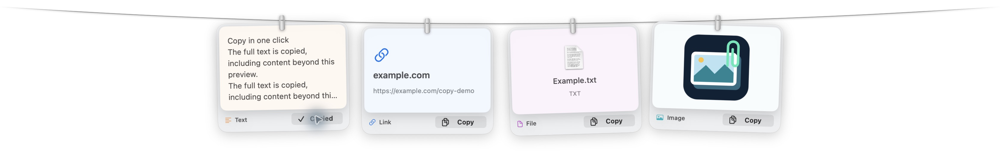
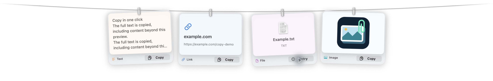

# 卡片 Copy 按鈕

日期：2026-10-11（America/Vancouver）。交付版本：1.1.6。

## 使用體驗

- 每種卡片的右下角都有常駐、帶圖示的 Copy 按鈕，取代原本的被動提示。
- 成功後顯示勾號與 Copied，兩秒後回復；連續複製會從最後一次操作重新計時。
- 無法讀取或檔案已遺失時顯示 Retry。這些讀取失敗不會清空既有剪貼簿；恢復檔案後可再次點擊重試。
- 文字複製完整內容，連結保留 URL 與純文字，檔案使用原始檔案 URL，圖片保留 PNG 與檔案 URL。
- 原生按鈕獨立處理滑鼠與可及性操作；複製不會觸發開啟、拖曳或圖片長按 Markup。卡片主體仍可開啟，右鍵選單仍可使用。
- 卡片主體與 Copy 按鈕有各自的可及性名稱及滑鼠提示。圖片名稱可透過主體提示取得。
- 在新項目預覽快要收起時複製，保留至少兩秒供閱讀回饋；手動顯示不會因此啟動新的收起計時器。

## 驗證

- **139 個完整測試全部通過**，零失敗，約 53 秒。新增九個測試，涵蓋獨立點擊區域、可及性動作、預覽期限、完整文字、遺失檔案、連續複製及成功／失敗狀態的實際 NSHostingView 更新。
- 原生驗證使用相同應用程式來源、隔離偏好與具名 pasteboard，不讀取或取代個人剪貼簿。從真實卡片按鈕依序複製文字、連結、檔案及圖片；文字為 **1,298 字元**，完整末行仍保留。
- 成功標籤與勾號實際可見；圖片 Copy 按住 0.7 秒後仍完成複製。故意移除驗證檔案會顯示 Retry，先前的圖片剪貼簿仍保留；恢復檔案後重試成功。
- 卡片主體的 Open 動作實際開啟 Preview，文件 URL 與驗證圖片一致。
- Native view 初版沒有收到 Copied 狀態更新，已改成明確傳遞狀態值，並新增 hosted-view 回歸測試，避免再出現「已複製但沒有畫面回饋」。
- arm64／x86_64 release app、strict codesign、DMG 與 ZIP 內的版本、內容及 SHA-256 全部核對通過。
- 本機安裝版本已更新至 1.1.6/build 8，執行檔與驗證候選相同；原版完整保留於 `build/backups/Clipline-installed-before-copy-button-20261011.app`。更新前後六張既有卡片與內容中繼資料一致。具名 pasteboard 的驗證結果、日誌及私有偏好備份保留在未追蹤的 `build/copy-evidence`。

原生驗證工具可用 `CLIPLINE_COPY_DEMO=1 scripts/demo/build-verification-app.sh <new-app-path>` 建立。測試用 Show cards 視窗只存在於此隔離工具，不出現在正式 app。

