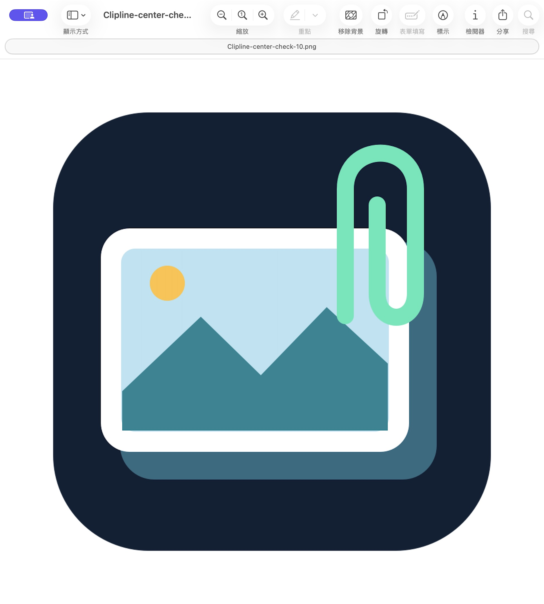
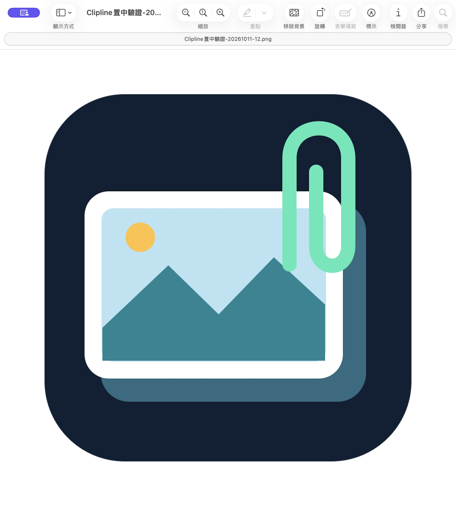

# macOS 預覽程式圖片視窗置中

日期：2026-10-11。依使用者選擇，保留 macOS「預覽程式」，只調整圖片視窗位置。

## 行為

- 點擊圖片卡片，以 Preview 開啟，置中於點擊當下游標所在螢幕的可用區域；不改視窗大小。
- 以 Accessibility 的完整文件路徑識別圖片，支援 Unicode、file URL、一般路徑與連結解析。同名但不同路徑的視窗不會移動；缺少文件身分時停止置中。
- 等待 Preview 視窗尺寸穩定後移動，讀回位置與大小才回報成功。最多重試 2.5 秒；後一次點擊取消前一次待處理請求。
- 未取得輔助使用權限仍正常開啟圖片。正式 app 首次需要時請求權限；授權後需再次點擊圖片。隔離驗證 app 不彈權限提示。

## 已驗證

- 完整測試 **130/130 通過**，零失敗，47.5 秒；含六個新增測試，涵蓋可用區域、左側與上方螢幕座標、無效幾何、同名文件、缺失身分及重複文件視窗。
- arm64 與 x86_64 release 建置通過，Universal 架構正確，`codesign --verify --deep --strict` 通過。編譯無 warning/error。
- 隔離原生驗證 app 的圖片卡片實際開啟 Preview；Accessibility tree 的文件 URL 與點擊的 `Clipline-center-check-10.png` 一致。
- 隔離驗證 app 最初回報 `needsAccessibility`，沒有修改權限。
- 使用者已確認套用修正版與啟用輔助使用權限。已安裝的 `~/Applications/Clipline.app` 已更新，SHA-256 與通過建置的候選 app 一致；原版完整保留於 `build/backups/Clipline-installed-before-centering-20261011.app`。
- 使用者完成 Touch ID 後，從系統設定加入已安裝的 Clipline；直接核對 `Clipline_Toggle` 為 `on`。未授權隔離驗證 app。
- **已完成原生端到端驗證**：從已安裝的 Clipline 點擊合成 PNG，再重啟 app 並點擊使用者提供的 `截圖 2026-10-11 18.48.36.png`；兩次 Preview 的文件 URL 都與卡片一致，均回報 `centered`。這個結果須先讀回視窗大小保持不變，且實際位置與預期中央位置的 x/y 誤差各小於 2 點，才會回報。
- 驗證圖片已移至 `build/centering-evidence/native-fixtures`，六張原有截圖卡片已還原。原檔未經修改。
- 本次實測使用內建顯示器；實體多螢幕仍以座標測試涵蓋，尚未完成硬體驗收。

原生日誌與建置／測試日誌保存在 `build/centering-evidence`。開啟證據：

授權後的已安裝 app：[原生置中日誌](evidence/preview-centering.log)。以下畫面確認仍使用 Preview，視窗位置以日誌所對應的 Accessibility 讀回結果驗證：

